  

 

<!--- RADAR & FOCUS --->

  

 

  

 

<!--- SELECTED WORK --->

  

 

<table width="100%" cellspacing="0" cellpadding="0" border="0">
<tr>
<td width="50%" valign="top" align="left">

</td>
<td width="50%" valign="top" align="right">

</td>
</tr>
<tr>
<td colspan="2" valign="top">
 
</td>
</tr>
<tr>
<td width="50%" valign="top" align="left">

</td>
<td width="50%" valign="top" align="right">

</td>
</tr>
<tr>
<td colspan="2" valign="top">
 
</td>
</tr>
<tr>
<td width="50%" valign="top" align="left">

</td>
<td width="50%" valign="top" align="right">

</td>
</tr>
</table>

 

<!--- ENGINEERING & PRINCIPLES --->

  

 

  

 

  

 

<!--- GITHUB ACTIVITY --->

  

 

  <table border="0" width="830" cellspacing="0" cellpadding="0">
    <tr>
      <td width="50%" align="center">
        
      </td>
      <td width="50%" align="center">
        
      </td>
    </tr>
    <tr>
      <td colspan="2" align="center">
         
        
      </td>
    </tr>
  </table>

 

<!--- ELSEWHERE --->

  

 

&nbsp;

&nbsp;

&nbsp;

