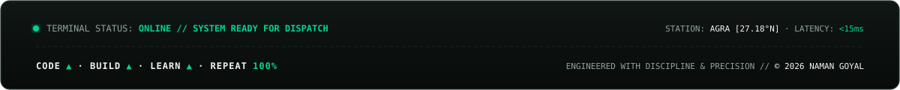

<p align="center">
  
</p>

<!-- Live Animated Dynamic J.A.R.V.I.S. Stream -->
<p align="center">
  <a href="https://github.com/namangoyal176-10">
    
  </a>
</p>

<!-- Quick Action Badges -->
<p align="center">
  <a href="https://linkedin.com/in/namangoyal176-10">
    
  </a>
  <a href="mailto:namangoyal176@gmail.com">
    
  </a>
  <a href="https://github.com/namangoyal176-10">
    
  </a>
  
</p>

<p align="center">
  
</p>

## 🛡️ About Me

```javascript
const naman = {
  codename:    "Naman Goyal",
  role:        "AI/ML Engineer & Full-Stack Developer",
  education:   "B.Tech CSE (AI/ML) @ Mirai School of Technology",
  location:    "Agra, Uttar Pradesh, India 🇮🇳",
  superpowers: ["C++ (DSA)", "Node.js", "Express.js", "MongoDB", "React", "Python"],
  focus:       "Applied AI/ML, High-Concurrency Web Systems & Algorithmic Problem Solving",
  mantra:      "Whatever it takes. Code. Build. Solve. Scale."
};
```

- ⚡ **Engineering Mindset:** Blending the analytical systems architecture of **Iron Man** with the agility of modern full-stack web engineering.
- 🧠 **Algorithmic Rigor:** Sharpening **Data Structures & Algorithms in modern C++** with a relentless focus on time and space complexity.
- 🦾 **Full-Stack & Systems:** Architecting scalable, ACID-compliant web applications and REST APIs using **Node.js**, **Express.js**, **MongoDB**, and **React**.
- 🤖 **Applied AI & Vision:** Engineering deep learning models (OpenCV, neural networks) for real-world environmental and agricultural decision support.

<p align="center">
  
</p>

## ⚡ Stark Tech Arsenal

<p align="center">
  
</p>

<div align="center">

| Division | Weapons & Technologies |
| :--- | :--- |
| **⚡ Core Propulsion** | `C++` · `JavaScript (ES6+)` · `Python` · `TypeScript` |
| **🌐 Holographic Frontend** | `React` · `HTML5` · `CSS3` · `Tailwind CSS` · `EJS` |
| **🦾 Vibranium Backend** | `Node.js` · `Express.js` · `MongoDB` · `Mongoose` · `REST APIs` |
| **🛠️ S.H.I.E.L.D. Tooling** | `Git` · `GitHub` · `VS Code` · `Vercel` · `OpenCV` · `FastAPI` |

</div>

<p align="center">
  
</p>

## 🚀 Featured Missions

<table>
  <tr>
    <td width="50%" valign="top">
      <h3>🌾 KisanMitra AI</h3>
      <p>End-to-end decision engine for smallholder potato and tomato farmers. Combines <b>Deep Learning Vision</b> for foliar disease detection with <b>Agro-Economic Forecasting</b> to reduce crop loss and market vulnerability.</p>
      <p>
        
        
        
      </p>
      <a href="https://github.com/namangoyal176-10/Aikissan">💻 Mission Code</a>
    </td>
    <td width="50%" valign="top">
      <h3>🛡️ RaceProof — Concurrency Engine</h3>
      <p>High-concurrency team formation platform built for hackathons supporting <b>10,000 concurrent participants</b>. Engineered with <b>ACID-compliant state mutations</b> for <b>zero race conditions</b> and sub-100ms discovery latency.</p>
      <p>
        
        
        
        
      </p>
      <a href="https://frontend-ivory-one-93.vercel.app">🌐 Live Deployment</a> ·
      <a href="https://github.com/namangoyal176-10/ps1">💻 Mission Code</a>
    </td>
  </tr>
  <tr>
    <td width="50%" valign="top">
      <h3>🚦 Smart Traffic Management System</h3>
      <p>Real-time municipal traffic flow optimization using an <b>Area-Occupancy Computer Vision System (OpenCV &amp; FastAPI)</b> to calculate true road density rather than simple bounding boxes, coupled with <b>NetworkX graph routing</b>.</p>
      <p>
        
        
        
      </p>
      <a href="https://github.com/namangoyal176-10/SMART-TRAFFIC-MANAGEMENT-SYSTEM">💻 Mission Code</a>
    </td>
    <td width="50%" valign="top">
      <h3>🎓 Course Management System</h3>
      <p>Full-stack academic course catalog and administration system featuring <b>JSON Web Token (JWT) authentication</b>, <b>Role-Based Access Control (RBAC)</b>, dynamic course modals, and student enrollment views.</p>
      <p>
        
        
        
        
      </p>
      <a href="https://github.com/namangoyal176-10/course-management-system">💻 Mission Code</a>
    </td>
  </tr>
  <tr>
    <td width="50%" valign="top">
      <h3>⚡ Pokédex Explorer</h3>
      <p>Responsive client-side Pokémon explorer built with <b>React</b> and <b>React Router DOM</b>. Integrates with the PokeAPI to provide real-time search filtering, dynamic route matching, and base stat visualizers.</p>
      <p>
        
        
        
      </p>
      <a href="https://ps3-pokedex-reactrouter.vercel.app">🌐 Live Deployment</a> ·
      <a href="https://github.com/namangoyal176-10/ps3-pokedex">💻 Mission Code</a>
    </td>
    <td width="50%" valign="top">
      <h3>🧩 Data Structures &amp; Algorithms in C++</h3>
      <p>Systematic implementation of core algorithms and data structures in <b>modern C++</b> (STL, pointers, dynamic memory, linked lists, trees, and sorting algorithms) completed at <b>Mirai School of Technology</b>.</p>
      <p>
        
        
        
      </p>
      <a href="https://github.com/namangoyal176-10/DSA-assignment.">💻 Mission Code</a>
    </td>
  </tr>
</table>

<p align="center">
  
</p>

## 📊 S.H.I.E.L.D. Mission Analytics

<div align="center">
  <table border="0">
    <tr>
      <td width="50%" align="center">
        
      </td>
      <td width="50%" align="center">
        
      </td>
    </tr>
    <tr>
      <td colspan="2" align="center">
        
      </td>
    </tr>
  </table>
</div>

<p align="center">
  
</p>

## 📡 Avengers Assemble // Connect

<p align="center">
  <b>Looking to collaborate, recruit, or discuss high-performance software engineering? Transmit a signal:</b>
</p>

<p align="center">
  <a href="https://linkedin.com/in/namangoyal176-10">
    
  </a>
  <a href="mailto:namangoyal176@gmail.com">
    
  </a>
  <a href="https://github.com/namangoyal176-10">
    
  </a>
</p>

<p align="center">
  
</p>
